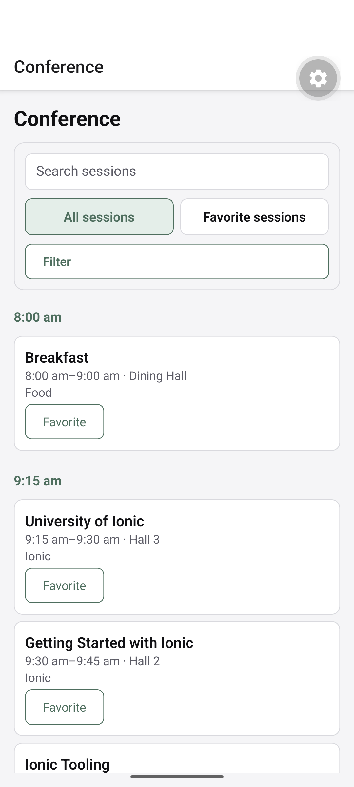
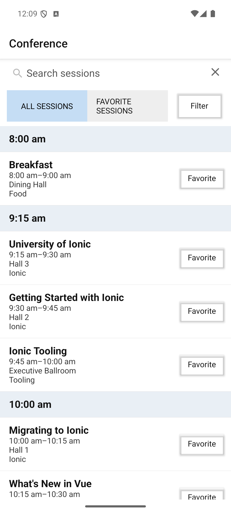
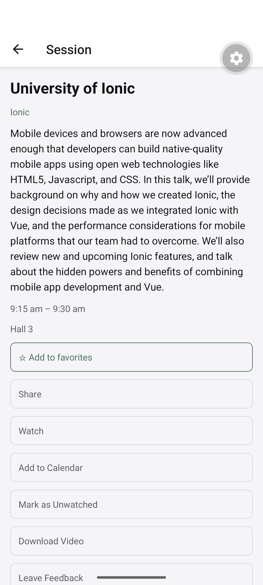
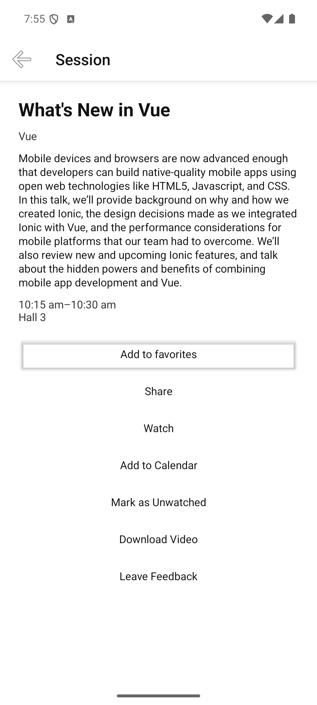
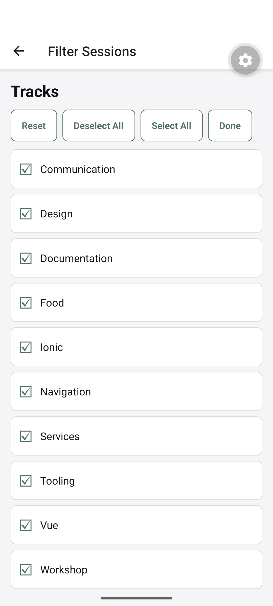
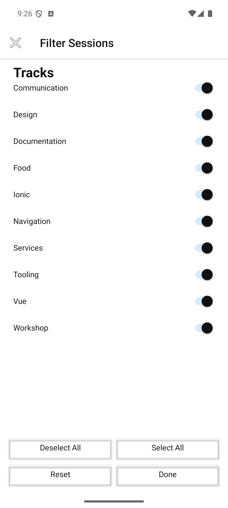
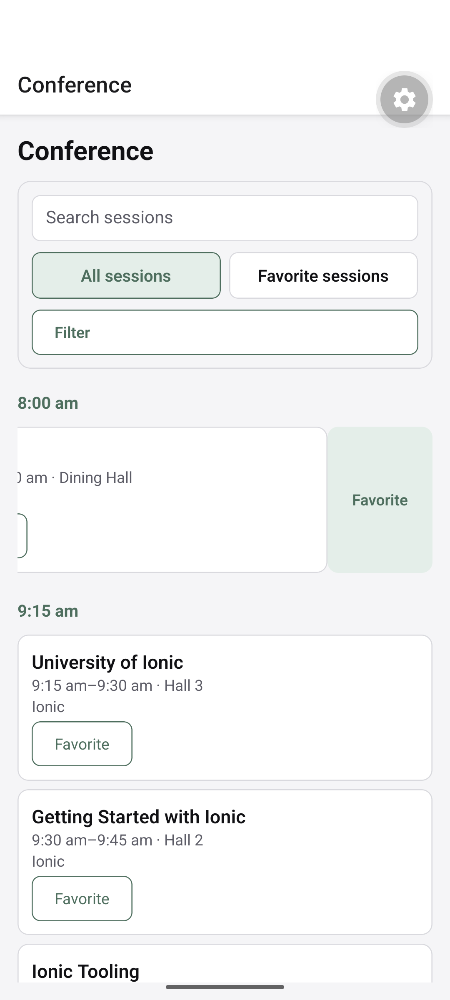
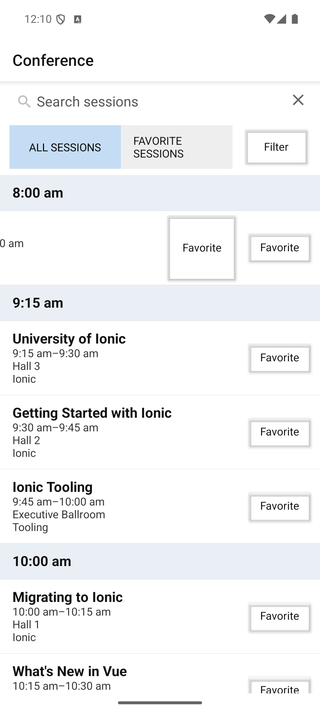
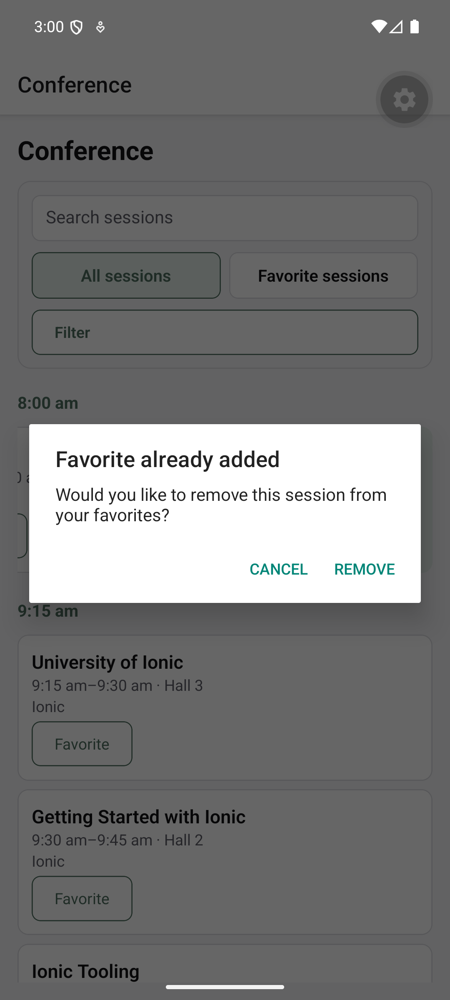
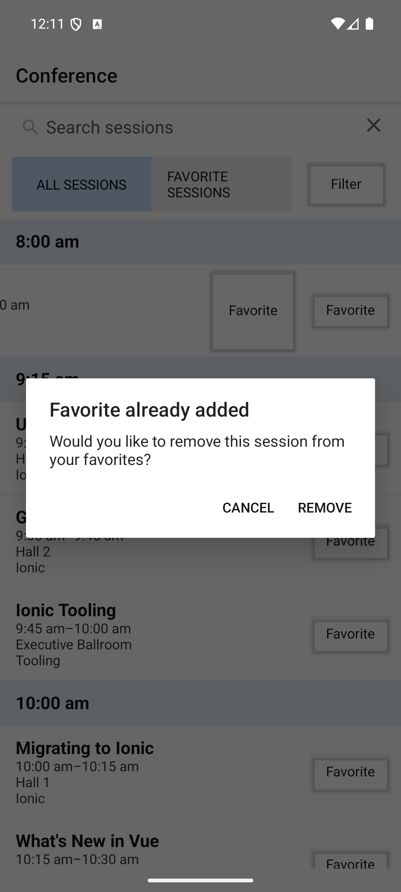

# Cross-platform app conversion

A proof of concept for translating an Ionic/Capacitor/Vue app into other cross-platform stacks. The source is the Ionic Conference App (Vue). The first target is React Native (Expo); the second is NativeScript-Vue.

The migration runs as small, reviewed work packages. An AI executor implements each package, and an independent AI reviewer checks it against hashed evidence before a human accepts and commits it.

## Repository layout

| Path | What it is |
| --- | --- |
| `src/`, `android/`, `ios/` | The original Ionic Vue app (Capacitor 8, Ionic Vue 9) |
| `migration/core/` | Framework-free TypeScript core shared by all targets: session selection, grouping, track sorting, favorites |
| `migration/reference/` | Behavior contract and frozen expected cases derived from the source app |
| `migration/react-native/` | React Native target (Expo SDK 58, Expo Router, React Native 0.88) |
| `migration/nativescript/` | NativeScript target (NativeScript-Vue 3, NativeScript 9, TypeScript) |
| `migration/plans/` | Migration strategy, work-package plan, Android acceptance checklist |
| `migration/work-packages/` | One specification per package (RN01–RN07, then NS01+) |
| `migration/submissions/`, `migration/reviews/` | Hashed manifests per revision and the reviewer verdicts |
| `migration/evidence/`, `migration/handoffs/` | Test, build and device evidence, and per-package handoffs |
| `migration/instructions/` | Executor and reviewer prompts |
| `migration/tools/manifest-hashes.mjs` | Writes and checks SHA-256 manifests for submissions |

## Status

- **React Native, done:** RN01–RN07. Expo shell and Android development build, core integration, schedule browsing, session detail and favorites, track filter modal, swipe actions on rows, and Android acceptance on an emulator. Known limits (native cold-start links, diagonal swipe, TalkBack traversal, keyboard insets) are listed in `migration/handoffs/RN07.md`.
- **NativeScript, in progress:** NS01–NS06 are done: shell and Android launch, shared core with the bundled fixture, Vuex-backed schedule list, session detail and favorites, track filter modal, and swipe actions on rows. NS07 (Android acceptance on an emulator) is under way.

## Screenshots

The same screens on an Android emulator, React Native on the left and NativeScript on the right. Both targets read the same fixture through the shared core. NativeScript uses the platform's default controls, so its tabs, switches and dialog buttons look more like stock Android.

| React Native (Expo) | NativeScript-Vue |
| :---: | :---: |
|  |  |
| Schedule grouped by start time | Schedule grouped by start time |
|  |  |
| Session detail | Session detail |
|  |  |
| Track filter modal | Track filter modal |
|  |  |
| Row swiped open to show Favorite | Row swiped open to show Favorite |
|  |  |
| Favoriting a session twice offers removal, as the source app does | Same dialog |

The grey gear in the React Native screenshots is the Expo development client's menu button. It is not part of the app.

## Running

Source app:

```bash
npm install
npm run dev
```

Shared core (builds, then runs its tests):

```bash
npm --prefix migration/core test
```

React Native target (needs an Android emulator or device with the development client installed):

```bash
npm --prefix migration/react-native install
npm --prefix migration/react-native run start
npm --prefix migration/react-native test
npm --prefix migration/react-native run typecheck
```

Metro runs on port 8082. For an emulator, forward it with `adb reverse tcp:8082 tcp:8082`.

NativeScript target (uses the project-pinned CLI through npx):

```bash
npm --prefix migration/nativescript install
npm --prefix migration/nativescript run typecheck
npm --prefix migration/nativescript test
npm --prefix migration/nativescript run build:android
```

Check a submission manifest:

```bash
node migration/tools/manifest-hashes.mjs migration/submissions/NS01-r1.json
```

## Workflow

1. A work package in `migration/work-packages/` defines scope, allowed files, checks and acceptance criteria.
2. The executor implements it in phases and records evidence under `migration/evidence/<package>/`.
3. The executor freezes a revision manifest (`migration/submissions/<package>-r<n>.json`) with SHA-256 hashes of every file.
4. The reviewer checks the frozen revision and records a verdict in `migration/reviews/`.
5. A human accepts and commits exactly the manifest's files.

## License

MIT. The source app is the Ionic Conference App, Copyright 2015-present Drifty Co. See [LICENSE](LICENSE).
